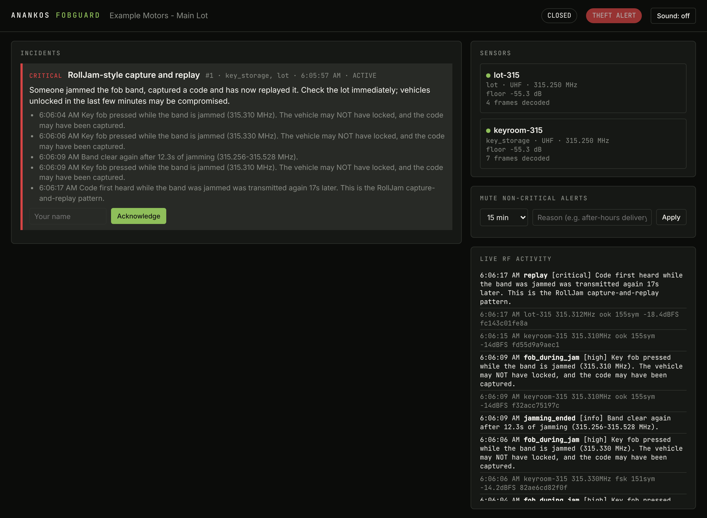
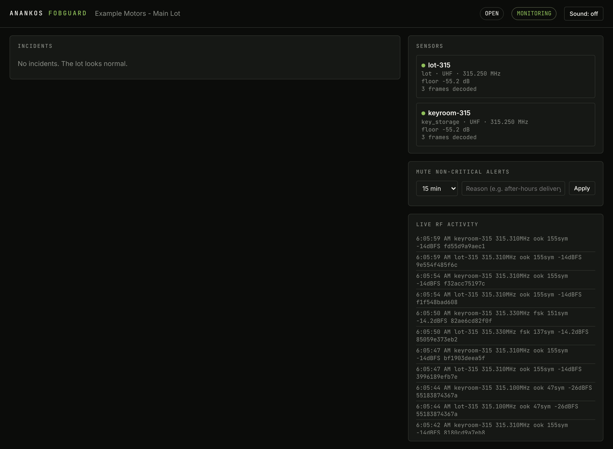
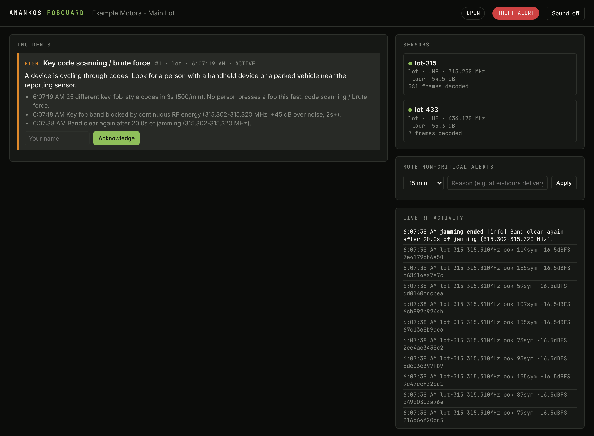
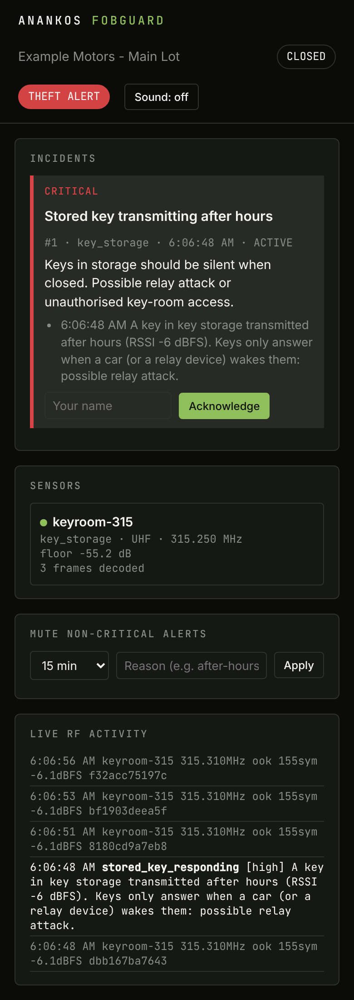
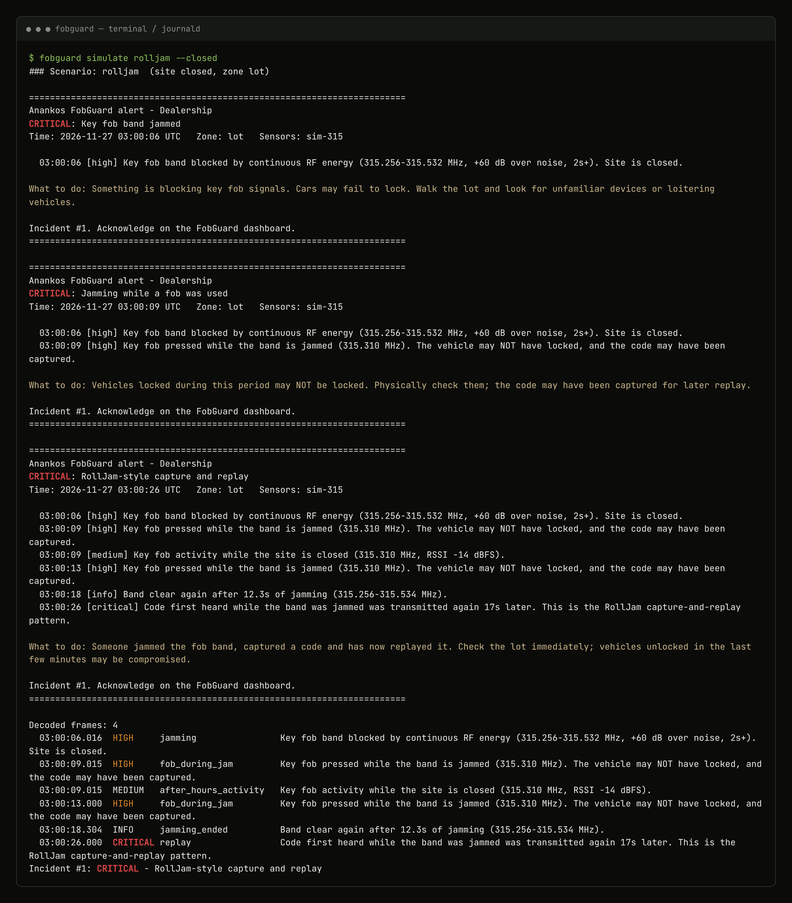
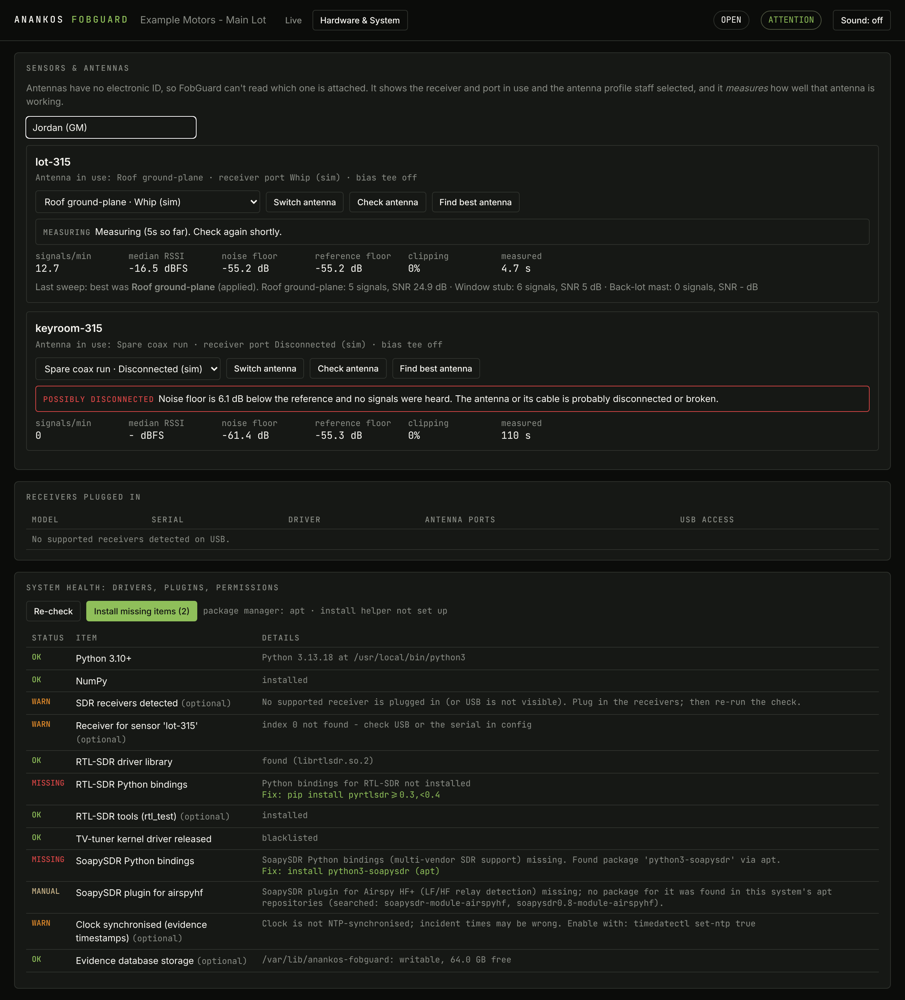
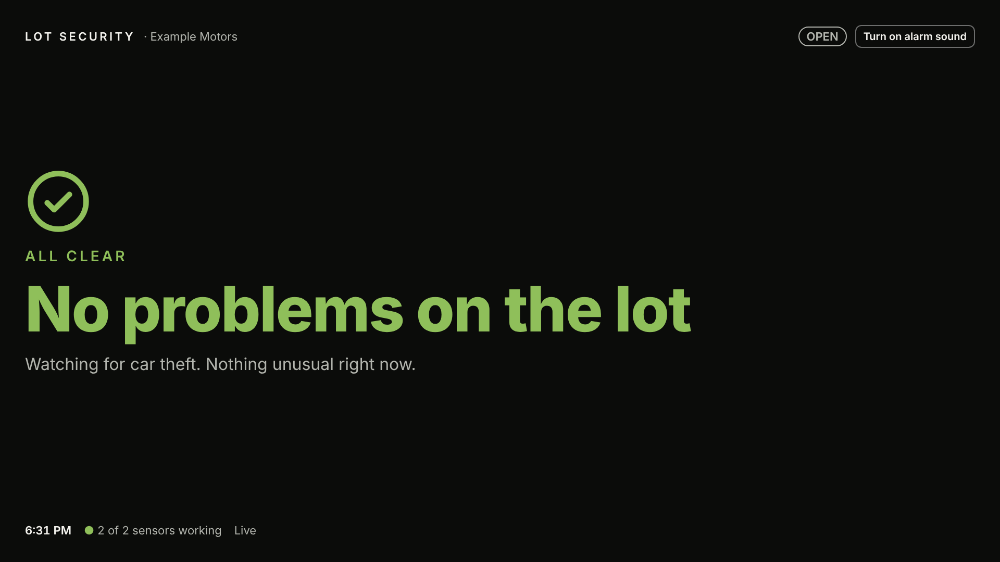
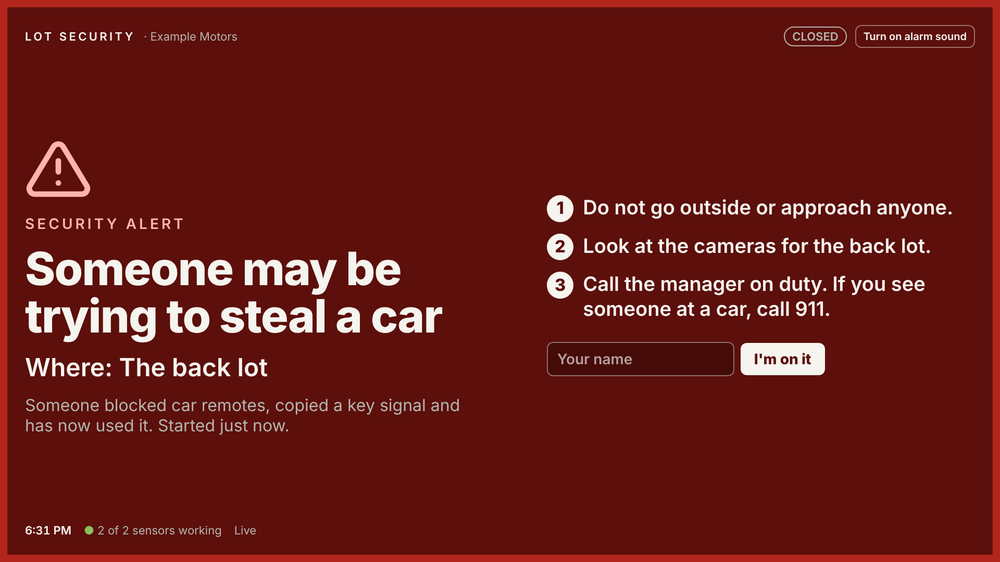
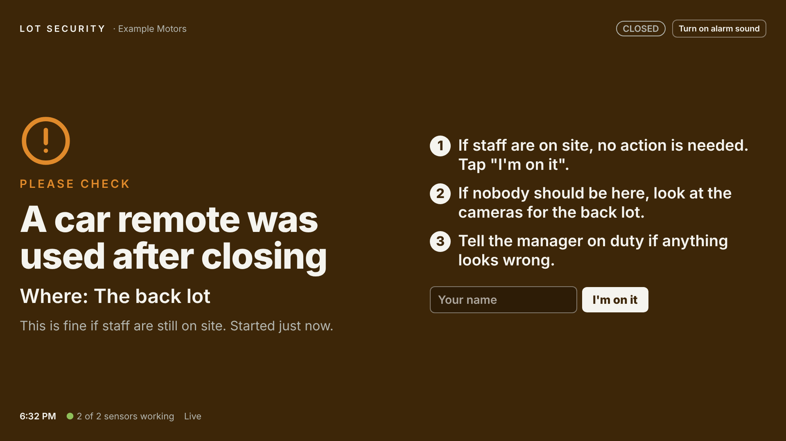
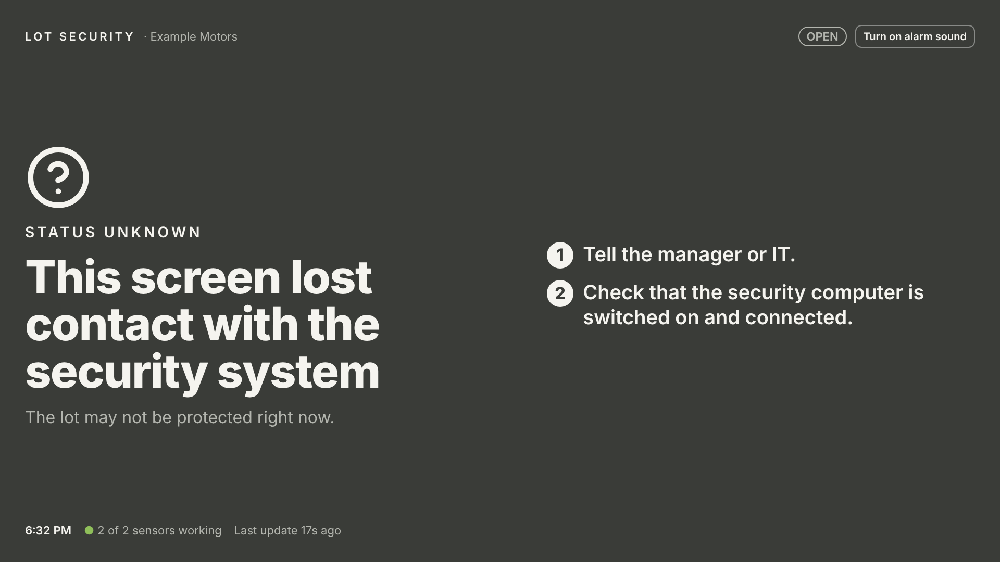

# Anankos FobGuard

Passive RF monitoring that warns dealership staff when key fob traffic on the
lot looks like **theft in progress** rather than normal use.

FobGuard runs on a small Linux box (Raspberry Pi 5, NUC, or any x86/ARM
machine) with one or more cheap software-defined radio receivers. It listens to
the key fob bands, decodes every remote-control frame it hears, and raises
alerts on the console, a local staff dashboard, Slack/Teams, email, syslog, or
a local siren relay.

> **FobGuard is receive-only.** It never transmits, jams, or interferes with
> any signal. Jamming is illegal in the US (47 U.S.C. §333) and most other
> jurisdictions. FobGuard is built to *detect* it.



| | |
|---|---|
|  |  |
| Normal traffic: frames decoded, no alerts | Brute-force code scanner detected |
|  |  |
| Phone view: stored key answering after hours | Console alerts escalating as the attack is identified |



*Hardware & System tab: antenna switching, live antenna health (a disconnected cable flagged on the key-room sensor), best-antenna sweep result, and the driver/plugin check with one-click install. Sensor data is simulated; the system check is real output from a Debian/Ubuntu host with no receivers plugged in.*

### Staff status board

A full-screen page for a TV in the sales office or a tablet at the front
desk. It's written for staff who don't know (or need to know) anything about
radio:

| | |
|---|---|
|  |  |
|  |  |

* **One message at a time:** *All clear*, *Please check*, *Security alert*
  or *System problem*. It says what's happening, where (in your own words for
  each zone), and the next three things to do. There's no jargon, and an
  automated test enforces that.
* **Safety first:** every theft alert starts with *"Do not go outside or approach
  anyone"*. Staff are told to use the cameras and call the manager or 911,
  never to intervene.
* **"I'm on it":** a staff member taps it with their name. The board then shows
  who is handling the incident, and the red flashing stops. The action is
  recorded on the incident.
* **Never a stale "all clear":** if the screen loses contact with FobGuard for
  12 seconds, it switches to *Status unknown* and tells staff to call the manager.
* **Optional alarm chime:** browsers need one tap to allow sound. Keeps the screen awake.

Open `http://<fobguard-host>:8742/board?token=<token>`. To run it on a
Raspberry Pi or mini-PC behind a TV as a kiosk:

```bash
chromium-browser --kiosk --noerrdialogs --disable-infobars --autoplay-policy=no-user-gesture-required \
  "http://fobguard.local:8742/board?token=YOUR_TOKEN"
```

Name your zones the way staff talk about them in the config:

```toml
[site.zone_names]
lot = "the back lot"
key_storage = "the key room"
```

---

## What it detects

| Attack | How FobGuard recognises it | Severity |
|---|---|---|
| **Jamming** (blocks a car from hearing "lock") | Sustained in-band energy for ≥2 s, tracked against a learned noise floor that an attacker can't slowly "teach" | High |
| **Fob used while jammed** | A real fob frame decoded *beside* an active jammer. The car may not be locked, and the code may have been captured | High |
| **Replay** of a captured rolling code | Rolling-code fobs never reuse a code. The same long code heard again after the press window is a replay | High |
| **RollJam** (jam, capture, replay later) | Replayed code was first heard during jamming | Critical |
| **RollBack** (rolling-code resync) | Two or more captured codes replayed back-to-back in their original order | Critical |
| **Code scanning / brute force** | Dozens of distinct, structurally identical codes per minute (e.g. hundreds per minute from a handheld scanner) | High |
| **Relay attack** on keyless entry | A sensor next to key storage hears a stored key answer after hours. With an optional LF sensor, also 125 kHz wake-up signals | High to Critical |
| **After-hours fob activity** | Any fob use while the site is closed (business hours and holidays are configurable) | Medium |
| **Sensor tampering / failure** | Receiver stops delivering samples, or is overloaded by a nearby transmitter | High / Medium |

High-severity attacks are escalated to **Critical** when the site is closed.

### Normal use vs. attack

Normal behaviour that FobGuard deliberately ignores:

* The 3–5 identical frames a fob sends for one button press, and quick double presses.
* Several staff members locking cars across the lot.
* Fixed-code gadgets (gate remotes, doorbells, weather and tire sensors) that
  repeat the same short code by design. These are recognised by frame length,
  periodicity, or learned during `fobguard calibrate`. You can also allowlist them by fingerprint.
* Key-room activity during business hours.

### What it can't see (be honest with customers)

* **USB-port ignition bypass** (the 2022–23 "Kia Boy" wave). That wave hit Kia/Hyundai
  models with turn-key ignitions and no engine immobiliser. It involves **no
  radio signal**. The defences are the manufacturer's software update,
  steering-wheel locks, and cameras. FobGuard doesn't help here.
* **CAN injection** through a headlight or bumper connector, **OBD-port key
  programming**, and physically stolen keys. None of these are radio attacks.
* **Relay attacks against keys stored far from any sensor.** Coverage depends on where
  sensors are placed. Store keys in a shielded (Faraday) cabinet regardless.
* **Encrypted challenge-response systems** are not decrypted. FobGuard works
  on timing and repetition, not by breaking crypto. That is enough to catch the
  attack *patterns* above.

---

## Hardware

| Item | Notes | Approx. cost |
|---|---|---|
| Host | Raspberry Pi 5 (4 GB+) or small x86 PC, wired Ethernet, UPS recommended | $80–300 |
| Receiver per band | RTL-SDR Blog V4 (or V3). One per frequency you monitor | ~$40 each |
| Antenna per receiver | Tuned 315 / 433 MHz whip or ground plane, mounted high with a lot view | $10–40 |
| Powered USB hub | If running ≥3 receivers on a Pi | $25 |
| *Optional* LF sensor | Airspy HF+ Discovery + 125 kHz loop antenna near key storage (via SoapySDR) | ~$200 |

**Bands:** 315 MHz covers most vehicles sold in North America (including
Kia, Hyundai, Toyota, Honda, GM, Ford). 433.92 MHz covers many European-sourced
vehicles and aftermarket remotes. In the EU, use 433.92 and 868.3 MHz.

**Placement:** one receiver pair overlooking each lot area, plus one
low-gain sensor inside or beside the key room or key cabinet (`zone =
"key_storage"`). Tune each dongle ~250 kHz off the fob frequency, as the
example config does, so the RTL-SDR DC spike stays clear of real signals.

---

## Install

```bash
git clone <this repo> && cd Anankos/fobguard
sudo ./deploy/install.sh
```

The installer (Debian / Ubuntu / Raspberry Pi OS) does the following:

* Installs `rtl-sdr`.
* Blacklists the kernel DVB driver.
* Adds a udev rule.
* Creates a `fobguard` service user.
* Installs into `/opt/anankos-fobguard`.
* Writes `/etc/anankos-fobguard/config.toml` and a random dashboard token.
* Installs a hardened systemd unit.

Then:

```bash
fobguard devices                                   # list receivers and serials
sudoedit /etc/anankos-fobguard/config.toml         # site name, hours, monitors, alert sinks
sudo -u fobguard fobguard calibrate -c /etc/anankos-fobguard/config.toml --minutes 30
sudo systemctl enable --now anankos-fobguard
journalctl -u anankos-fobguard -f
```

The dashboard is at `http://<host>:8742/?token=<token from /etc/anankos-fobguard/env>`.
It shows live incidents with what-to-do instructions, sensor health, an
acknowledge button, an audible alarm, and a "mute non-critical alerts" control
for after-hours deliveries. Critical alerts are never muted.

### Drivers and plugins: `fobguard doctor`

```bash
fobguard doctor                 # check everything; nothing is changed
sudo fobguard doctor --fix      # install what's missing (asks first; --yes to skip)
fobguard doctor --fix --dry-run # show the exact commands it would run
```

The doctor works out what this site needs from the config and from the
receivers actually plugged in. It then checks:

* Python and NumPy.
* The RTL-SDR library and bindings.
* The SoapySDR bindings, plus the right plugin for each receiver (Airspy,
  Airspy HF+, HackRF, LimeSDR, USRP, Pluto).
* The TV-tuner kernel driver that steals RTL-SDR dongles.
* USB permissions and the udev rule.
* Clock sync (evidence timestamps), storage, and dashboard protection.

Missing items are **searched for in this OS's own package manager** (apt,
dnf, pacman, Homebrew) or pip, and installed. If the package index is
empty, it is refreshed first. The doctor also detects version clashes: for
example, `pyrtlsdr` 0.4+ won't load against the stock Debian/Ubuntu
`librtlsdr`, so it installs the compatible 0.3.x instead.

Only items on a built-in allowlist can ever be installed, and no shell is
involved. Proprietary vendor drivers (the SDRplay API) are listed as manual
steps.

On the dashboard, **Hardware & System → Install missing items** does the
same thing. The web service has no root rights. It only drops a request
naming check IDs. A root helper (`anankos-fobguard-fix.path`) re-runs the
checks itself, installs allowlisted fixes for checks that still fail, and
restarts FobGuard.

### Antennas

Antennas are passive, so **no software can identify which antenna is
attached**. FobGuard identifies the *receiver* (model, serial, driver, antenna
ports) and lets you describe your antennas as `[[antenna]]` profiles. The
**Hardware & System** tab then offers four controls:

* **Switch antenna:** changes the receiver port (multi-port SDRs) and/or drives an
  external RF switch, and powers active antennas through the bias tee. FobGuard
  re-learns the noise floor so the change never looks like jamming. Every switch is
  audit-logged with the staff member's name.
* **Check antenna:** measures the antenna in place: signals per minute, RSSI,
  noise floor against the calibrated reference, and clipping. It flags *probably
  disconnected*, *weak compared with another antenna*, *wrong band* or *overloaded*.
* **Find best antenna:** tries each option for about a minute and keeps the one
  that hears the most distinct signals with the best margin over the noise.
* **Bands:** an antenna whose `band_mhz` doesn't cover the sensor's frequency
  can't be selected by mistake.

A single-port RTL-SDR needs an external coax switch to change antennas
remotely. Otherwise it's one antenna per receiver, which is cheap at about $40 each.

### Calibration

Run `fobguard calibrate` for 20–30 minutes under normal conditions. It records:

* Each sensor's **noise floor**, so jamming detection is armed from the first
  second after a reboot. An attacker can't jam during start-up to poison it.
* **Fixed-code devices** heard repeatedly (gates, sensors), so they never alert.
* The **strongest RSSI** per sensor. Press a fob inside the key room and set
  `key_storage_rssi_dbfs` a few dB below what the key-room sensor reports.

If any detection fires during calibration, the command warns you. Don't trust
that baseline until you've investigated.

---

## Try it without radios

Synthetic scenarios exercise the full pipeline:

```bash
pip install .
fobguard simulate all                     # normal, rolljam, replay, rollback, bruteforce, relay
fobguard simulate rolljam --dashboard     # watch it live at http://127.0.0.1:8742/
fobguard simulate normal --closed         # same traffic after hours -> medium only
```

## Analyse a recording

Captures from `rtl_sdr` (`.cu8`), `.cs16`, or `.cf32` files can be analysed
offline, for example from a night you suspect something happened:

```bash
rtl_sdr -f 315250000 -s 1024000 -g 40 night.cu8
fobguard analyze night.cu8 --freq 315.25 --rate 1024000 --start 2026-11-27T01:30:00-06:00 --json report.json
```

Every decoded frame, detection, and incident is also stored in SQLite
(`/var/lib/anankos-fobguard/fobguard.db`) as an evidence trail.

---

## Alert sinks

Configure as many as you like under `[[alerts.sink]]`, each with its own `min_severity`:

* `console`: stderr / journald.
* `webhook`: `format = "slack" | "teams" | "json"`.
* `email`: SMTP with STARTTLS.
* `syslog`: local socket or `host:port`. Forward to your SIEM.
* `command`: runs a local program with the incident JSON on stdin, for example to trigger a siren or strobe relay.

Use `${ENV_VAR}` in the config for secrets, and keep them in `/etc/anankos-fobguard/env`.

---

## How it works

```
 RTL-SDR / SoapySDR / file / sim
          │ complex IQ blocks
          ▼
 SpectrumMonitor  ── Blackman-Harris FFT frames ─► per-bin noise floor (slow, jam-proof)
          │                                     └► duty-cycle EMA ─► JamEvent (≥2 s)
          │ bursts (also inside a jammer's skirts, and chopped from continuous streams)
          ▼
 demodulate()  ── channel filter, OOK / 2-FSK slicer ─► pulse timings
 split_frames() ── base-unit estimate, timing-quality check ─► quantised frames
          ▼
 DetectorSuite ── replay · RollJam · RollBack · brute force · relay · after-hours · jam context
          ▼
 Correlator ── groups detections into incidents, names the attack, escalates when closed
          ▼
 AlertManager / Dashboard (SSE) / SQLite
```

Processing runs about 3x faster than real time per receiver at 1.024 MS/s on a
laptop core. On a Pi 5, use one receiver per core, or lower `sample_rate` to
`0.25e6` when you run more than three receivers.

## Development

```bash
pip install -e '.[test]'
pytest -q
```

## Legal and privacy

* Receive-only. Do not modify FobGuard to transmit.
* FobGuard logs timing fingerprints of fob frames, not owner identities. Set a
  retention policy for the SQLite file in line with your privacy notice.
* Check local law before deploying outside the US.

© Anankos. All rights reserved.
